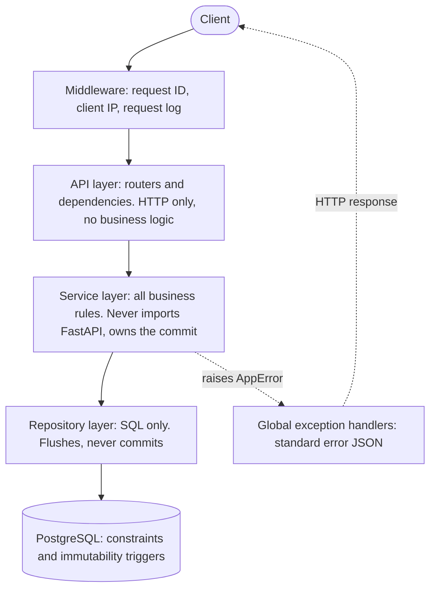
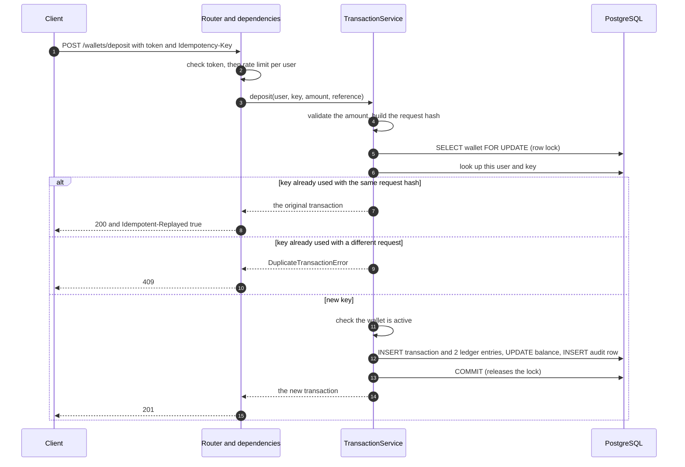
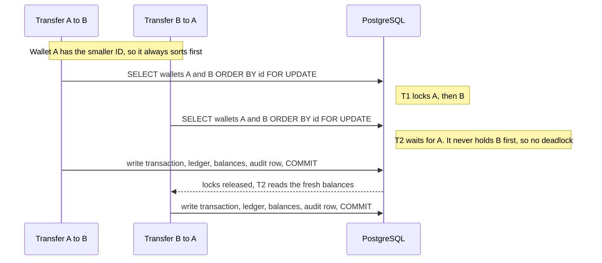
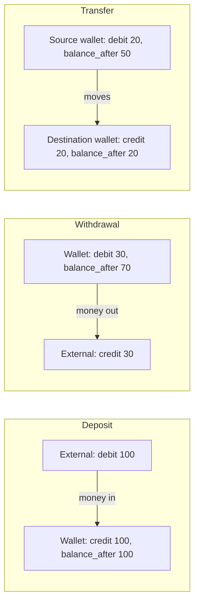
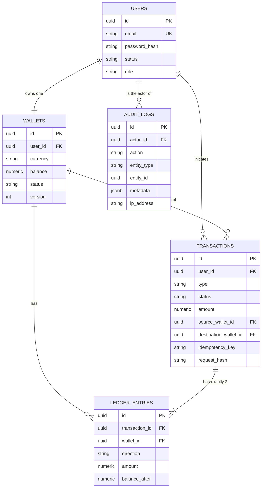

# Architecture

How the Wallet & Transaction Service is built. GitHub renders the diagrams below. In VS Code, install a Mermaid preview extension to see them.

## 1. Layers

Every request goes down one layer at a time. A layer talks only to the layer directly below it.

Where things live:

| Layer | Folder | Rule |
|---|---|---|
| API | `app/api/` | Parses the request, calls one service, returns the response. `deps.py` is the only place repositories are wired into services. |
| Service | `app/services/` | Validates, applies business rules, and owns the DB transaction. |
| Repository | `app/repositories/` | One class per table. No business rules. |
| Models and schemas | `app/models/`, `app/schemas/` | SQLAlchemy tables and Pydantic request/response shapes. |
| Core | `app/core/` | Settings, security, money validation, idempotency hash, pagination, rate limiter. |

## 2. Request flow: a deposit

One deposit is one database transaction. The wallet row is locked first, so parallel requests for the same wallet queue up instead of overwriting each other.

Withdrawals follow the same path, with two extra checks after the frozen check and before anything is written: enough balance, then the daily limit. A rejected request raises an error, nothing is written, and the lock is released when the session closes.

## 3. Why transfers cannot deadlock

A transfer touches two wallets. If A to B locked A then B, while B to A locked B then A, each would wait for the other forever. Instead, both wallets are locked in one query ordered by ID, so every transfer takes locks in the same order.

The balance check and the daily limit run **after** the locks are taken, so they see committed data and cannot be beaten by parallel requests.

## 4. The ledger model

Convention, from the wallet's point of view: a **credit** puts money in, a **debit** takes money out. Every transaction has exactly two entries, and its debits equal its credits.

| Transaction | Wallet entry | Other entry |
|---|---|---|
| Deposit | credit the user's wallet | debit **external** (no wallet) |
| Withdrawal | debit the user's wallet | credit **external** (no wallet) |
| Transfer | debit the source wallet | credit the destination wallet |

"External" is a ledger entry with `wallet_id` empty and `balance_after` empty. There is no system wallet, so there is no hot row that every deposit would fight over, and `CHECK (balance >= 0)` never needs an exception.

Each wallet entry stores `balance_after`, the wallet balance right after it. That gives statements a running balance, and lets an auditor verify that each wallet's balance equals the sum of its entries.

## 5. Database schema

Rules the database enforces by itself, whatever the application does:

- `wallets.balance >= 0`, and one wallet per user.
- `amount > 0` on transactions and ledger entries.
- Deposits have only a destination, withdrawals only a source, and transfers both (and they differ).
- `UNIQUE (user_id, idempotency_key)`.
- Triggers reject any `UPDATE` or `DELETE` on `ledger_entries` and `audit_logs`, any `DELETE` on `transactions`, and any `UPDATE` of a completed transaction.

## 6. Safety nets, from outside in

| Layer | What it catches |
|---|---|
| Rate limiter | Floods and brute force, before any database work |
| Validation | Bad amounts, bad IDs, bad headers (422) |
| Idempotency | Retries and duplicates, so money never moves twice |
| Row locks | Lost updates, overdrafts and daily-limit races |
| Database constraints | A bug that slips past all of the above (negative balance, wrong shape) |
| Triggers | Any attempt to rewrite history |
| Ledger auditor | Whether the books add up (used in tests, and usable as a nightly job) |